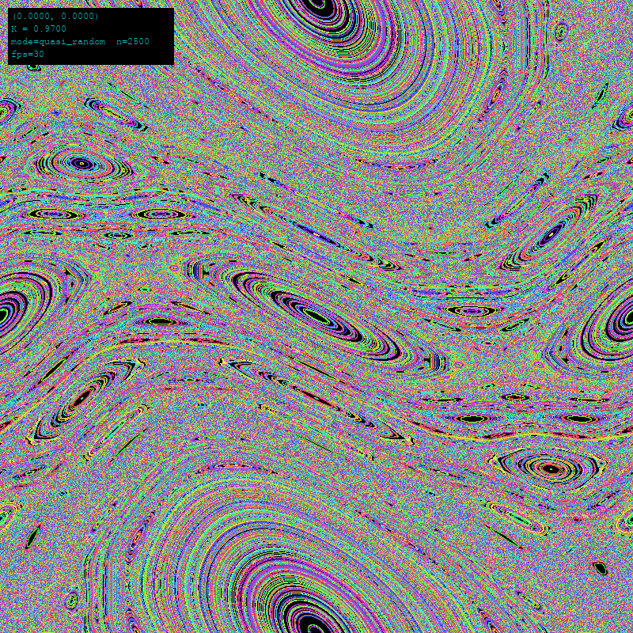
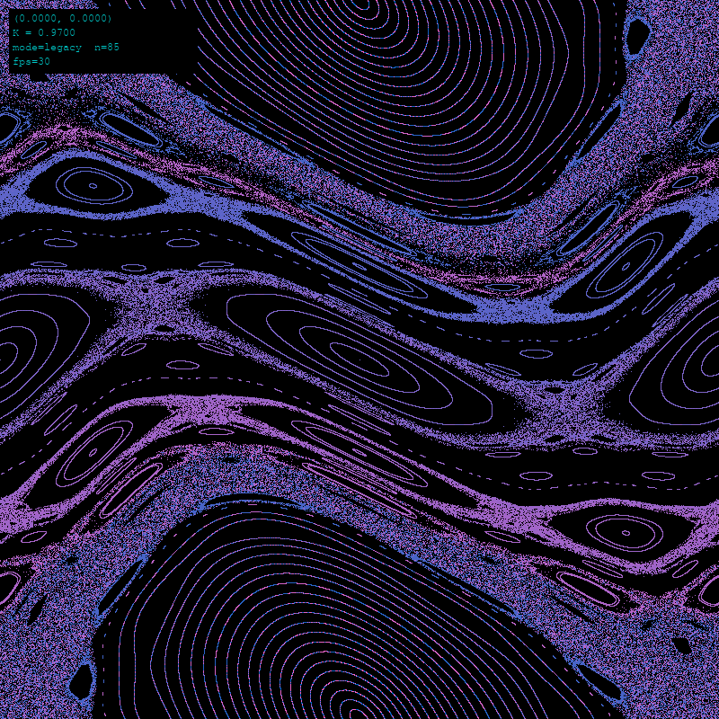
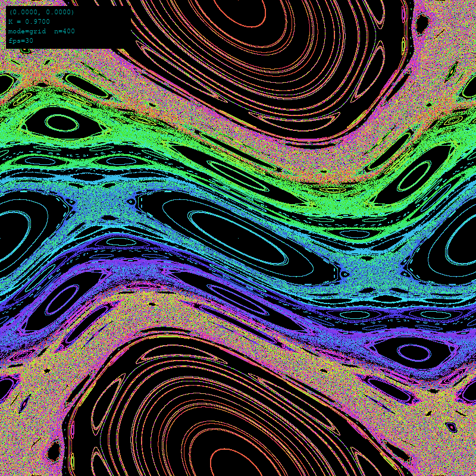
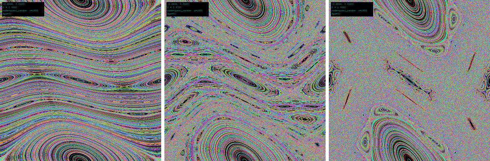
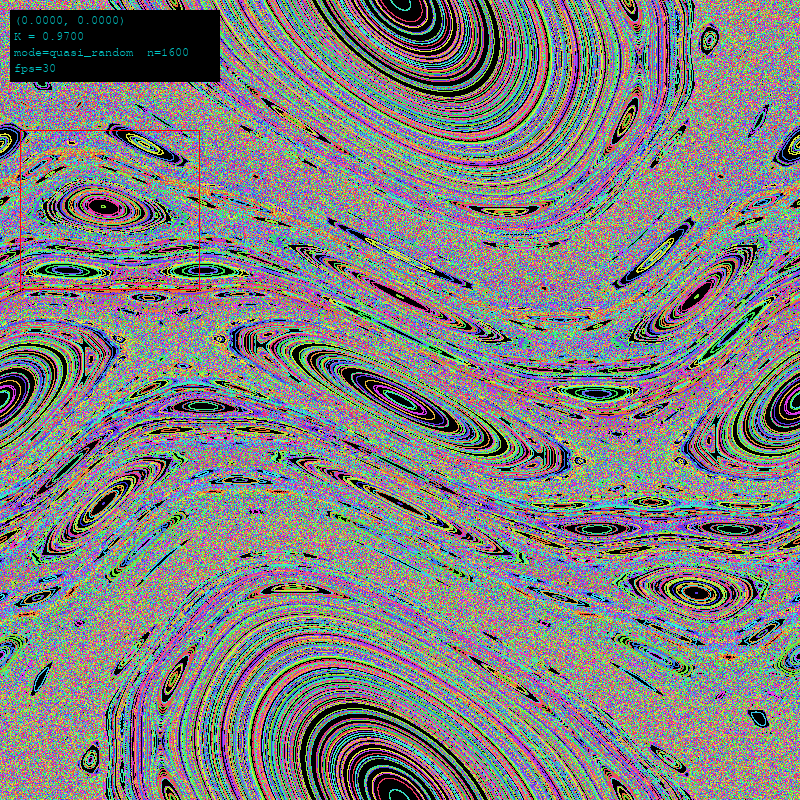
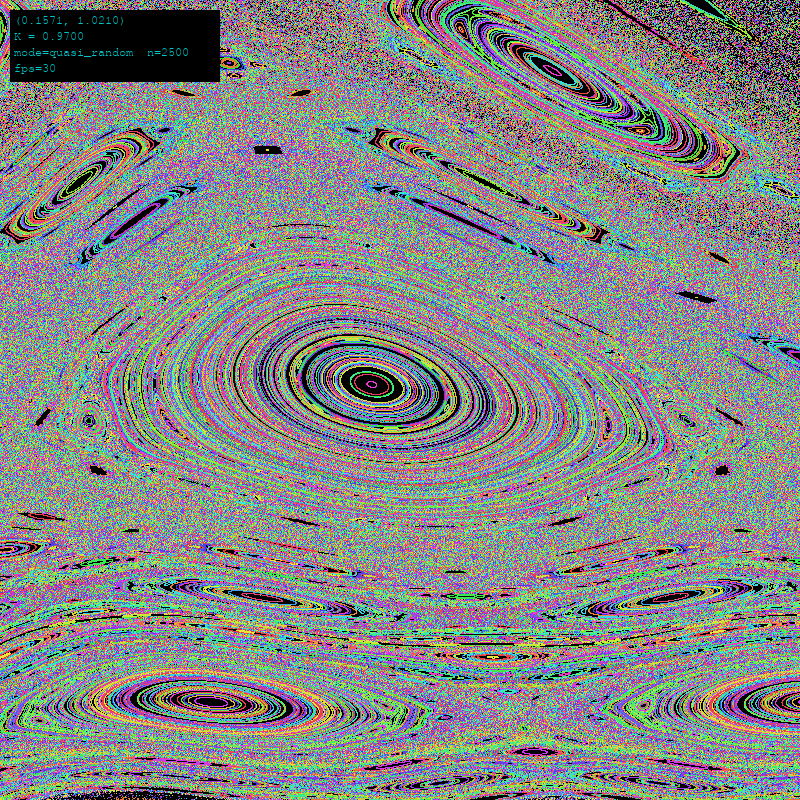

StandardMap
===========

An interactive viewer for the **Chirikov Standard Map**, the textbook model of how a
Hamiltonian system goes from orderly, quasi-periodic motion (KAM tori) to chaos. You can
drag a rectangle to zoom into any region and see the self-similar structure of islands
around islands, and you can change the nonlinearity `K` live.



*K = 0.97, just below Greene's critical value K_c ≈ 0.9716, with 2,500 quasi-random
initial conditions. Elliptic islands (closed curves) sit inside a chaotic sea (speckle).*

This started as a Processing sketch from 2012 (`StandardMap.pde`). The Python version
keeps all of the original's behaviour and seeds trajectories across the whole phase
space, so far more of the fractal structure shows up.

## The map

On the torus [0, 2π) × [0, 2π):

```
y_{n+1} = (y_n + K · sin(x_n))  mod 2π
x_{n+1} = (x_n + y_{n+1})       mod 2π
```

Each trajectory gets its own color, and every point it visits stays on screen, so
regular orbits trace out closed curves and chaotic orbits fill in areas.

## Gallery

### How the seeds are placed changes what you see

| Original 1-D sweep (`legacy`, 85 orbits) | 2-D grid (`grid`, 400 orbits) |
|:---:|:---:|
|  |  |

- **`legacy`** reproduces the Processing sketch. All 85 orbits start on a single
  vertical line, so any structure that line doesn't cross never appears.
- **`grid`** starts orbits on a 2-D grid. With the default HSV palette the hue follows
  the seed's row, and the color bands stay separate. At K < K_c the surviving KAM tori
  act as transport barriers: an orbit that starts in one chaotic layer can't get into
  the next.
- **`quasi_random`** (the top image) uses a scrambled Halton sequence. That avoids the
  aliasing a regular grid can have with the map's own periodicity, and it fills the
  portrait most evenly.

### The transition to chaos



*Left to right: K = 0.5, 0.97, 1.5.* At K = 0.5 most of phase space is still covered by
tori that span the whole x-range. At 0.97 the last spanning torus is about to break up.
At 1.5 orbits diffuse globally and only the larger islands are left. Press `↑`/`↓` to
step through K yourself.

### Zooming in

| Drag a rectangle… | …and the viewer reseeds inside it |
|:---:|:---:|
|  |  |

Zooming doesn't just magnify the existing points. Every zoom **reseeds all trajectories
inside the new viewport**, so detail fills in at full density at any depth. In this
example, a primary island of the 1/4 resonance turns out to be surrounded by its own
chain of secondary islands. The HUD shows the corner of the current viewport in data
coordinates. Double-click or press `r` to go back to the full view.

## Quick start

You need [uv](https://docs.astral.sh/uv/) and Python 3.11+.

```bash
uv sync                    # create .venv and install deps
uv run standard-map        # open the viewer
```

Some other ways to start it:

```bash
uv run standard-map --seed-mode quasi_random --nx 50 --ny 50   # 2,500 orbits
uv run standard-map --K 1.2 --color-mode legacy_rgb
uv run standard-map --seed-mode legacy                          # the original sketch
uv run python -m standard_map                                   # same as standard-map
```

## Controls

| Input | Action |
|---|---|
| Drag | Zoom into the rectangle (and reseed inside it) |
| Double-click, `r`, `Esc` | Reset to the full torus |
| `s` | Switch seed mode: grid → quasi_random → legacy |
| `↑` / `↓` | Raise / lower K by 0.01 |
| `+` / `-` | Raise / lower seed density by 5 per axis (5–100) |
| `q` | Quit |

## Configuration

Every calibration value has a default in `standard_map/config.py` and can be
overridden. Command-line flags take precedence over a TOML file, and the TOML file
takes precedence over the defaults.

| Flag | Default | Meaning |
|---|---|---|
| `--K` | `0.97` | Nonlinearity parameter |
| `--seed-mode` | `grid` | `grid`, `quasi_random` or `legacy` |
| `--nx`, `--ny` | `20`, `20` | Seeds per axis (grid and quasi_random modes) |
| `--color-mode` | `hsv_cycle` | `hsv_cycle` or `legacy_rgb` (the Processing palette) |
| `--rng-seed` | none | Fixes the Halton scramble so runs are reproducible |
| `--config` | none | TOML file with any of the values below |

[`standard_map.example.toml`](standard_map.example.toml) lists every setting with its
default: window size, frame rate, iterations per frame, K step, density limits,
double-click timing, palette and HUD layout. Copy it, edit it, and run:

```bash
uv run standard-map --config my_settings.toml
```

## Project layout

```
standard_map/
  config.py       enums + frozen dataclasses for every tunable; TOML loading
  exceptions.py   StandardMapError hierarchy
  seeding.py      grid / quasi_random / legacy seeders
  map_engine.py   vectorized map iteration (numpy)
  viewport.py     data <-> pixel transform and zoom
  projection.py   project a batch of iterations to pixels and clip
  color.py        per-trajectory color tables
  renderer.py     pygame drawing: points, HUD, zoom rectangle
  gestures.py     double-click and drag state machines (no pygame)
  controls.py     key bindings table and window caption
  app.py          App orchestrator, build_app(), main()
  cli.py          argparse -> AppConfig
scripts/make_screenshots.py   regenerates the images in docs/screenshots/
tests/                        pytest suite (runs headless)
StandardMap.pde               original Processing sketch (reference)
```

## Development

```bash
uv run pytest                          # tests; fails below 80% coverage
uv run ruff check standard_map tests   # lint
uv run mypy                            # strict type check
uv run python scripts/make_screenshots.py   # rebuild README images
```

The tests and the screenshot script run pygame with `SDL_VIDEODRIVER=dummy`, so they
don't need a display. The screenshots are deterministic because `--rng-seed` fixes the
quasi-random seeds.

## References

- B. V. Chirikov, "A universal instability of many-dimensional oscillator systems,"
  *Physics Reports* 52, 263 (1979).
- J. M. Greene, "A method for determining a stochastic transition,"
  *J. Math. Phys.* 20, 1183 (1979). This is where K_c ≈ 0.9716 comes from.
- A. J. Lichtenberg & M. A. Lieberman, *Regular and Chaotic Dynamics*, 2nd ed.
  (Springer, 1992).
